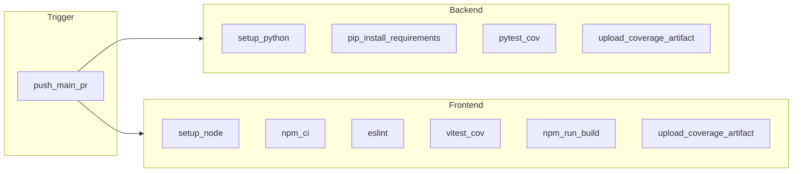

# Plan: pruebas unitarias/funcionales, CI y cobertura

## Estado actual

- **Backend**: Ya existe una base sólida de pruebas **funcionales / API** en [`backend/tests/test_api.py`](backend/tests/test_api.py): `httpx.AsyncClient` + `ASGITransport`, BD SQLite en fichero aislado, override de `get_db`. Cubre auth, usuarios, citas, franjas horarias y `/health`.
- **Dependencias**: [`backend/requirements.txt`](backend/requirements.txt) incluye `pytest`, `pytest-asyncio`, `httpx`; **no** incluye `pytest-cov`.
- **Frontend**: [`frontend/package.json`](frontend/package.json) solo tiene `lint` y `build`; no hay Vitest/Jest ni scripts de test.
- **CI**: No hay [`.github/workflows/`](.github/workflows/) ni `.gitlab-ci.yml` en el repo.
- **Nota**: En la raíz del proyecto hay scripts tipo [`test_api.py`](test_api.py) con `requests` contra un servidor levantado; son **smoke manuales**, no pytest. Conviene mantener la fuente de verdad en `backend/tests/` y evitar duplicar lógica.

## 1. Cobertura y configuración de pytest (backend)

- Añadir **`pytest-cov`** a [`backend/requirements.txt`](backend/requirements.txt).
- Crear **`pytest.ini`** (o sección `[tool.pytest.ini_options]` si más adelante migráis a `pyproject.toml`) con:
  - `asyncio_mode = auto` (alineado con pytest-asyncio reciente).
  - Opcional: **marcadores** `integration` / `unit` para distinguir tests HTTP vs tests puros.
- Añadir **`.coveragerc`** (o `[tool.coverage.run]` en pyproject) para:
  - `source = app`
  - `omit` de migraciones, `__main__`, etc. si aplica.
- Comando local estándar:

```bash
cd backend && pytest --cov=app --cov-report=term-missing --cov-report=xml --cov-report=html
```

- **`coverage.xml`** y carpeta **`htmlcov/`** sirven para CI y revisión local; el XML es el que suelen consumir Codecov/Sonar.

## 2. Ampliar la suite (equilibrio unitario vs funcional)

| Capa | Qué hacer |
|------|-----------|
| **Funcionales (API)** | Seguir el patrón actual del `client` fixture. Añadir tests para routers **sin cobertura explícita**: [`notifications`](backend/app/api/v1/endpoints/notifications.py), [`exercises`](backend/app/api/v1/endpoints/exercises.py), [`reports`](backend/app/api/v1/endpoints/reports.py) — al menos un caso feliz y uno de error (401/403/404) por recurso crítico. |
| **Unitarias** | Extraer o testear **servicios y utilidades** sin levantar HTTP: por ejemplo funciones en [`backend/app/services/`](backend/app/services/) y [`backend/app/utils/`](backend/app/utils/) (hashing, validaciones, transformaciones). Tests rápidos en `backend/tests/unit/` con mocks cuando toque Redis/email/Twilio. |

No hace falta cubrir el 100 % en la primera iteración; sí **subir cobertura de los módulos de negocio** y **evitar regresiones** en endpoints nuevos.

### SQLite vs PostgreSQL en tests

Los tests actuales usan **SQLite** (`sqlite+aiosqlite`) porque:

- **Velocidad y fricción cero**: no hace falta Docker ni servicio en CI; cada suite crea su propia BD de fichero o `:memory:` y la borra al terminar.
- **SQLAlchemy unifica la mayor parte del código**: CRUD, relaciones y la mayoría de consultas del proyecto se comportan igual en ambos motores para lo que suele cubrir una API REST típica.
- **Menos flakes**: menos dependencia de red, puertos y orden de arranque del contenedor Postgres.

**No es “mejor” Postgres en todos los casos**, pero **sí es más fiel a producción** cuando:

- Hay SQL **específico de Postgres** (tipos JSONB, arrays, `ILIKE` vs comportamiento distinto, locking, transacciones aisladas distintas).
- Las **migraciones Alembic** solo se validan de verdad contra el motor destino.
- Ya habéis tenido bugs solo visibles en Postgres (zonas horarias, `asyncpg`, etc.).

**Estrategia recomendada (combinable)**:

1. **Mantener SQLite** como base rápida para la mayoría de tests de API en cada push (lo que ya tenéis).
2. **Opcional**: segundo job en CI con **servicio Postgres** (`services:` en GitHub Actions) y `DATABASE_URL` apuntando a esa instancia, más un fixture alternativo o marcador `@pytest.mark.postgres` para un subconjunto de tests críticos o para ejecutar **toda** la suite contra Postgres en `main` o en nightly.

Así no sacrificáis velocidad en cada PR y seguís teniendo **paridad** donde importa.

## 3. Frontend: Vitest + React Testing Library

- Instalar **Vitest**, **@testing-library/react**, **@testing-library/jest-dom**, **jsdom**, y **`@vitest/coverage-v8`** (o `istanbul` según preferencia).
- En [`frontend/vite.config.ts`](frontend/vite.config.ts), añadir bloque `test: { environment: 'jsdom', ... }` y script `"test": "vitest run"` / `"test:coverage": "vitest run --coverage"`.
- Empezar con **2–4 tests** representativos: un componente pequeño o utilidad (p. ej. formateo de fechas o un fragmento de página que no dependa del backend en vivo), usando **mocks de axios** si hace falta.

## 4. Pipeline CI

Se recomienda **GitHub Actions** (si el remoto es otro, la misma lógica se traslada a GitLab CI / Azure Pipelines).

Flujo propuesto (un job o dos en paralelo):



**Backend**: `actions/setup-python` (p. ej. 3.12), `pip install -r backend/requirements.txt`, `pytest` desde `backend/` con variables de entorno mínimas si [`app/config.py`](backend/app/config.py) las exige en import (revisar que los tests no dependan de `.env` real; si sí, usar `env:` en el workflow o defaults de test).

**Frontend**: `actions/setup-node`, `npm ci` en `frontend/`, `npm run lint`, `npm run test:coverage`, `npm run build`.

**Artefactos**: subir `backend/htmlcov` y/o `coverage.xml`, y `frontend/coverage` con `actions/upload-artifact` para descargar informes desde la pestaña Actions.

**Opcional**: subir `coverage.xml` a **Codecov** con el token en GitHub Secrets para badges y diff en PRs.

## 5. Entregables concretos

1. `pytest-cov` + configuración de coverage + scripts/comandos documentados en README solo si ya pedís documentación (según vuestra regla: no crear markdown no solicitado; el equipo puede copiar los comandos del plan o del workflow).
2. Tests adicionales backend (notifications, exercises, reports) + carpeta `unit/` incremental.
3. Vitest en frontend + scripts en `package.json`.
4. Workflow `.github/workflows/ci.yml` (nombre flexible) que falle si tests o lint fallan y archive cobertura.

## Riesgos / detalles a validar al implementar

- **Config**: Si `settings` lee variables obligatorias al importar la app, el CI debe definirlas o usar un `.env.test` committed solo con valores dummy (sin secretos).
- **Tests lentos o flaky**: Los `asyncio.sleep` en citas son tolerables; si molestan en CI, valorar `pytest-asyncio` + esperas más deterministas (eventos o mocks del servicio de notificaciones).
